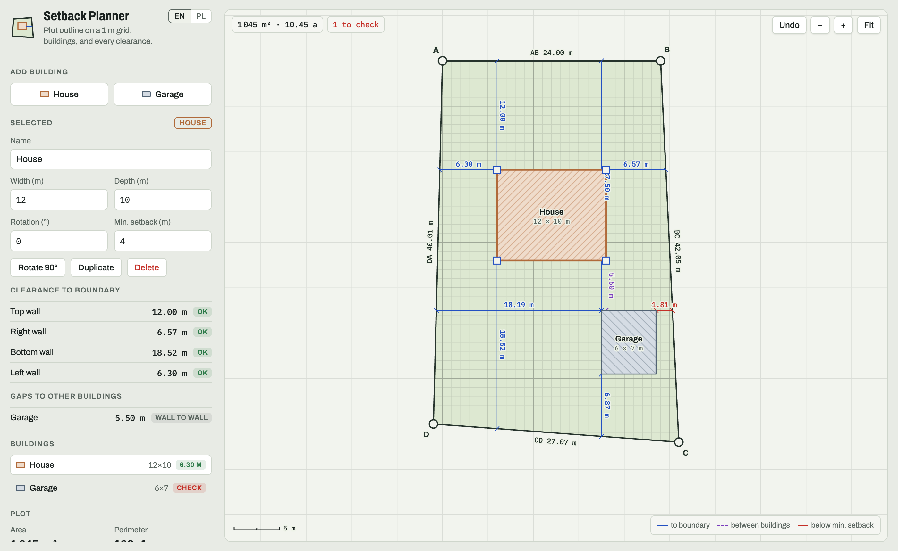
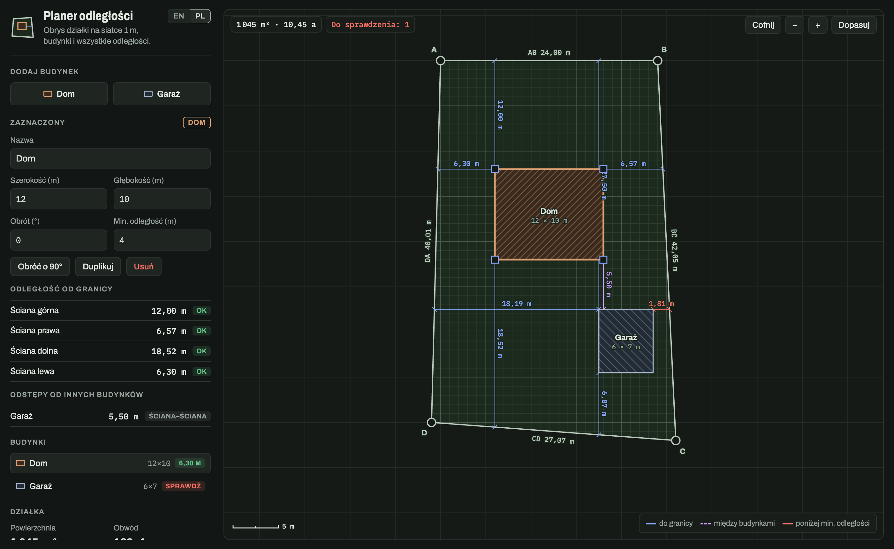
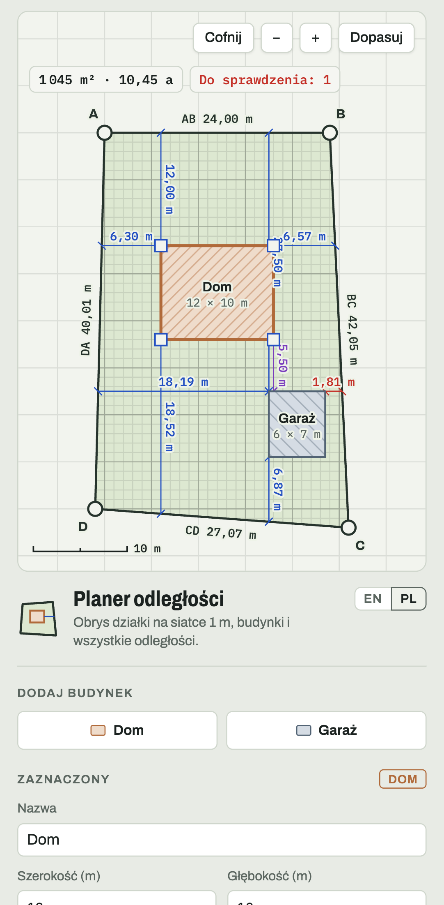

# Setback Planner

**Live: https://setback-planner.paperplane.builders**

Draw a four-corner plot on a 1 m grid, place houses and garages, and see every clearance to the boundary and between buildings. Walls closer than their minimum setback are flagged. Defaults follow Polish WT §12: 4 m for a wall with windows or doors facing the boundary, 3 m for a blank wall.

- English and Polish UI. It follows the browser language (Polish for `pl`, English otherwise), and the EN/PL toggle overrides it.
- The plan autosaves in the browser and in the page address, so the link is a shareable copy of the plan.
- Undo, snapping, JSON export/import, and pan/zoom/pinch on touch screens.



<table>
  <tr>
    <td width="68%"></td>
    <td></td>
  </tr>
</table>

## Development

The existing SVG editor is bundled with Vite. New domain modules use TypeScript. Node 22.18+ is required for the unit test runner.

```bash
npm ci
npx playwright install chromium
npm run dev
npm run typecheck
npm run lint
npm test
npm run test:e2e
npm run build
```

Feature backlog: [docs/features.json](docs/features.json). Inventory and decisions: [docs/repository-audit.md](docs/repository-audit.md). Handoff: [docs/implementation-status.md](docs/implementation-status.md).

## Deploy

Cloudflare Worker Static Assets serves `dist` after `npm run build`. Existing custom domain configuration is preserved. Deployment is separate from local implementation:

```bash
npm run build
npx wrangler deploy
```
